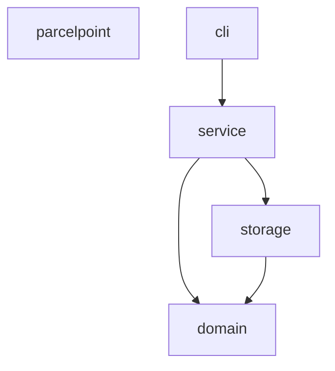
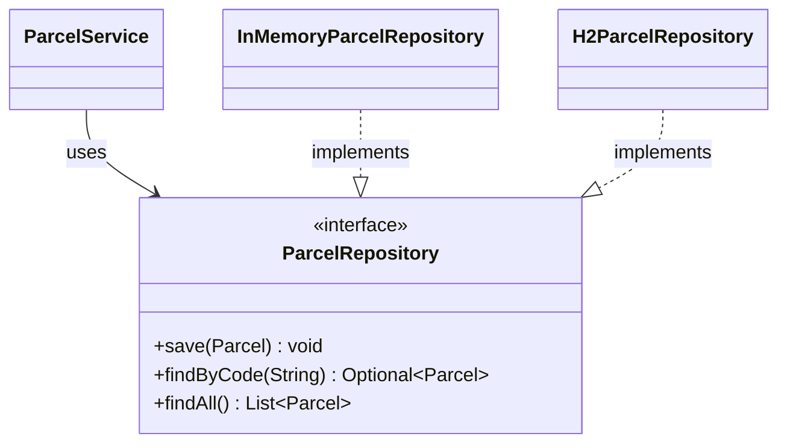
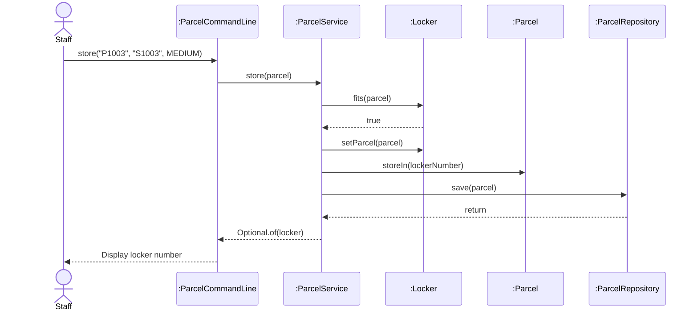

# Lab Report, Designing the Data Management Layer with H2

Repository URL: https://github.com/finsrps/itcs382-h2-lab

## Tools

| Item | Version or name |
| --- | --- |
| JDK | 21.0.13 |
| Maven | 3.10.0 |
| IDE | Visual Studio Code |
| AI tool and exact model, if you used one | |

## Part 0. From a store in memory to H2

Commit of the starter, before any change: 40c17a1

0.3 Your prediction for `staff`, written before the second run:

Output of the second run, for `staff` and `quit`:

```text
I predict that staff will show no parcels and all three lockers will be free because the parcels were stored in memory, which disappears when the program ends.

```

State in one sentence where you think the parcels of the first run were kept.

0.5 The line of Main that you would change to keep the parcels somewhere else:

```java
ParcelRepository repository = new InMemoryParcelRepository();
```

0.6 Commit of the switch to H2: 85bee64

0.7 Output of `SELECT * FROM PARCEL;` after you stored two parcels:

```text
CODE  | STUDENT_ID | PARCEL_SIZE | STATUS | LOCKER_NUMBER
P1001 | S1001      | SMALL       | STORED | 1
P1002 | S1002      | LARGE       | STORED | 3
(2 rows, 22 ms)
```

0.8 Explain why ParcelPoint could not start while the H2 Shell was open, and identify the class that wrote the message `Cannot create the PARCEL table`.
H2 Shell locked the database, so another program could not access it. The error was written by H2ParcelRepository.

0.9 Explain why `staff` shows no parcel while `find` shows each one, and why all three lockers look free.
The `staff` command shows no parcels because `findAll()` in H2ParcelRepository returns an empty list. ParcelService uses `findAll()` to reload parcels into lockers, so all three lockers appear free. However, `find` uses `findByCode()`, which reads parcels directly from the database.

0.11 Your findAll method:

```java
    @Override
public List<Parcel> findAll() {
    List<Parcel> parcels = new ArrayList<>();
    String sql = "SELECT * FROM PARCEL";

    try (Connection connection = connect();
         Statement statement = connection.createStatement();
         ResultSet rows = statement.executeQuery(sql)) {

        while (rows.next()) {
            parcels.add(toParcel(rows));
        }
    } catch (SQLException e) {
        throw new IllegalStateException("Cannot read parcels", e);
    }

    return parcels;
}
```

Commit that adds findAll:

0.12 Output of `SELECT * FROM PARCEL;` after the pickup:

```text
sql> SELECT * FROM PARCEL;
CODE  | STUDENT_ID | PARCEL_SIZE | STATUS    | LOCKER_NUMBER
P1001 | S1001      | SMALL       | PICKED_UP | null
P1002 | S1002      | LARGE       | STORED    | 3
(2 rows, 24 ms)
```

0.13 Optional. Describe what `find P9999'OR'1'='1` showed while the SQL was joined from strings, and what it showed after you put the placeholder back.
The query `find P9999'OR'1'='1` showed all parcels because the input was joined directly into the SQL query. After using a placeholder (`?`), the input was treated as a value, so no matching parcel was found.

## Part A. Model the design

A1 Complete the flowchart with one node for each package and one arrow for each dependency, from the package that uses to the package that is used. Mark the package that accesses the data store.



State whether cli depends on storage, and explain why.
No. The cli depends on service, not directly on storage. The service accesses the storage through the ParcelRepository interface.

A2 Complete the class diagram of the data management layer with ParcelService, the interface ParcelRepository with its three operations, and the two classes that implement it.




A3 Draw a sequence diagram for the command `store P1003 S1003 MEDIUM`, from the staff member to the repository. Show each message as an operation of the class that receives it.



Explain why the last lifeline is the interface ParcelRepository rather than H2ParcelRepository.
- The ParcelService depends on the ParcelRepository interface, not directly on H2ParcelRepository. This allows the storage implementation to be changed without modifying the business logic.

## Part B. Design questions

1. Identify the files that you changed to move from the store in memory to H2, and explain why no other class had to change. Use the terms of this course.
- Main.java and H2ParcelRepository.java were changed. ParcelService depends on the ParcelRepository interface, so other classes did not need to change.

2. The PARCEL table stores the size of a parcel as SMALL, MEDIUM or LARGE rather than as 1, 2 or 3. Identify the type of connascence between ParcelSize and the table in each case, and explain which one is weaker.
- SMALL, MEDIUM and LARGE use Connascence of Name. Numbers 1, 2 and 3 use Connascence of Value. Connascence of Name is weaker.

3. Project Phase 2 asks for a data store that needs no separate server. Explain why an embedded database such as H2 meets this rule, and describe the limit of an embedded database that Step 0.8 showed.
- H2 runs inside the application without a separate server. However, only one program can access the database file at a time.

4. State the data store that you would choose for your Project Phase 2 team, files or an embedded database, the requirement that drives the choice, and the package that will access it.
- I would choose H2 because it stores persistent data without a separate server. The storage package will access it.

## AI usage declaration

| AI tool and exact model | Date | Purpose | Files or answers it produced or changed | How you checked its output |
| --- | --- | --- | --- | --- |
| ChatGPT (GPT-6) | 13 Nov 26| Coding support | Suggested code for findAll() | Tested with Maven and H2 SQL |
